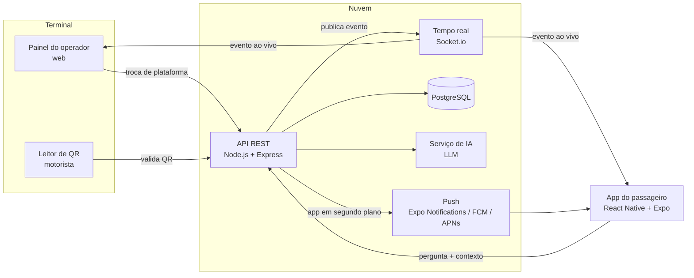
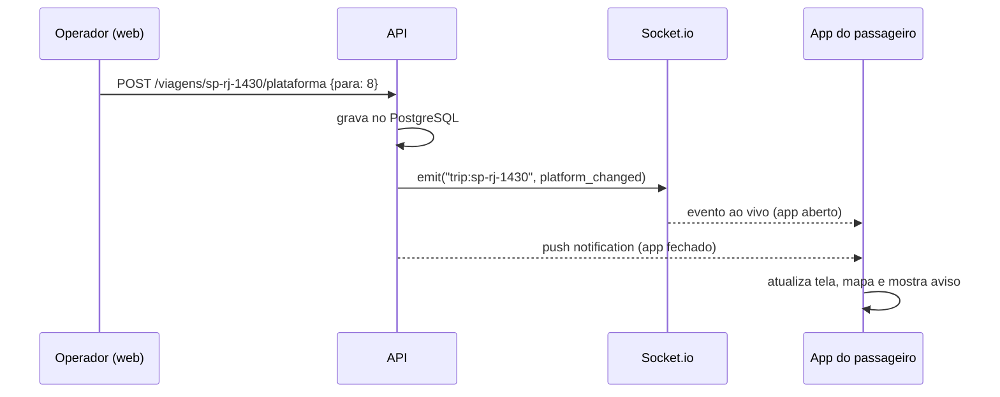

# Arquitetura — ClickBus Embarque

Este documento explica como o MVP está organizado hoje e como ele se conecta a um backend real na versão de produção.

## 1. Visão geral

O sistema tem três perfis de uso, todos ligados por **eventos em tempo real**:

| Perfil | Onde roda | O que faz |
| --- | --- | --- |
| Passageiro | App ClickBus (iOS/Android) | Modo terminal, mapa, avisos, QR, assistente |
| Operador do terminal | Painel web | Troca plataforma, registra atraso, libera embarque, vê ocupação |
| Motorista / portão | Celular ou leitor fixo | Lê o QR e confirma o embarque |



## 2. Como está no MVP (simulado)

O app foi escrito para que **nenhuma tela dependa de onde os dados vêm**. Toda comunicação passa por duas interfaces:

### Canal de tempo real — `src/services/realtime.ts`

```ts
interface RealtimeChannel {
  publish(event: RealtimeEvent): void;
  subscribe(handler: (event: RealtimeEvent) => void): () => void;
}
```

- **Hoje:** `MockRealtimeChannel` entrega o evento dentro do próprio app com 250 ms de atraso, simulando a rede. Na web, também repassa o evento para as outras abas abertas via `BroadcastChannel`. Por isso o painel do operador numa aba atualiza o app do passageiro em outra.
- **Produção:** uma classe `SocketIoRealtimeChannel` implementa a mesma interface conectando ao servidor Socket.io. Basta trocar a linha `export const realtime = new MockRealtimeChannel()`.

### Eventos (`src/data/types.ts`)

| Evento | Quem publica | Efeito no app |
| --- | --- | --- |
| `platform_changed` | Operador | Aviso vermelho, plataforma e rota atualizadas |
| `delay` | Operador / sistema da viação | Aviso amarelo, status "Atrasado" |
| `boarding_soon` | Sistema (horário) | Aviso "Embarque em 10 minutos" |
| `boarding_open` | Operador / motorista | Aviso verde "Embarque liberado" |
| `passenger_boarded` | Leitor de QR | Contador de embarcados, tela de confirmação |

O estado da viagem fica em `src/store/trip-store.tsx` (React Context + `useReducer`). O reducer `applyEvent` transforma cada evento em mudança de estado e, quando o evento é da viagem do passageiro, gera o aviso exibido pelo `NotificationBanner`.

### Assistente — `src/services/assistant.ts`

- **Hoje:** regras por palavra-chave usando os dados reais da viagem (plataforma, horário, bagagem).
- **Produção:** `askAssistant()` chama `POST /assistente` no backend, que monta o prompt com o contexto do pedido (viagem, plataforma, serviços do terminal, regras de bagagem da viação) e chama um modelo de IA generativa. A chave da IA fica só no servidor, nunca no app.

## 3. Backend proposto

| Camada | Tecnologia sugerida | Responsabilidade |
| --- | --- | --- |
| API | Node.js + Express (ou Java + Spring Boot) | Pedidos, partidas, plataformas, validação de QR |
| Tempo real | Socket.io (WebSocket) | Eventos ao vivo para app e painel; uma "sala" por viagem (`trip:<id>`) |
| Banco | PostgreSQL | Viagens, plataformas, embarques, histórico de avisos |
| Push | Expo Notifications (FCM/APNs) | Avisos quando o app está fechado |
| IA | API de LLM via backend | Assistente de viagem |
| Hospedagem | Render, Railway ou AWS | Deploy da API e do Socket.io |

### Exemplo de endpoints

```
GET  /viagens/:id                    → dados da viagem do passageiro
GET  /terminais/:id/partidas         → partidas do dia (painel)
POST /viagens/:id/plataforma         → { para: 8, motivo } — publica platform_changed
POST /viagens/:id/atraso             → { minutos: 15 } — publica delay
POST /viagens/:id/embarque/liberar   → publica boarding_open
POST /embarques/validar              → { qr } — valida e publica passenger_boarded
POST /assistente                     → { pergunta, viagemId } — resposta da IA
```

### Fluxo da troca de plataforma em produção



## 4. Evolução (visão de futuro do kickoff)

| Visão ClickBus | Versão MVP | Próximo passo |
| --- | --- | --- |
| Reconhecimento ao chegar (raio de 500 m) | Botão "Cheguei na rodoviária" | Geofencing com `expo-location` |
| Portões inteligentes / biometria | QR code | NFC e validação facial com consentimento (LGPD) |
| Totens cognitivos | Assistente no app | Mesmo assistente em totem com voz |
| Gêmeo digital do pátio | Mapa estático + ocupação por plataforma | Localização indoor (beacons BLE) e sugestão automática de plataforma por ocupação |
| Notificações contextuais | Avisos por evento | Avisos pela posição do passageiro e tempo até a plataforma |

## 5. Segurança e privacidade

- O QR contém apenas o localizador e a viagem; em produção ele é **assinado** pelo backend para não ser falsificado e pode ser validado offline pelo leitor.
- Localização e dados de acessibilidade só com consentimento explícito (LGPD).
- Chaves de IA e de push ficam no servidor.
